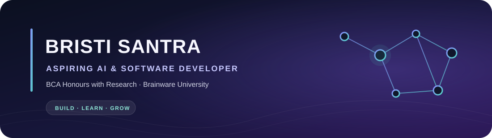

  
   
  
<strong>Building practical software while growing my programming foundations.</strong>

  
  

---

## 👋 About me

I’m **Bristi Santra**, a BCA Honours with Research student at **Brainware University**. I enjoy learning by building small, useful software projects, and I’m beginning to explore AI and machine learning.

| ✨ | A little about me |
| --- | --- |
| 🎓 **Studying** | BCA Honours with Research · Department of Computational Sciences |
| 📍 **Based in** | West Bengal, India |
| 🎯 **Interested in** | Software development, practical applications, and AI fundamentals |
| 🌱 **Growing through** | Project work, programming practice, and clear documentation |

## 🚀 Projects

### 🛒 [Fresh Grocery Store](https://github.com/slyrn-star/grosary-store)

A full-stack learning project with a responsive storefront and a Python API.

- **Features:** product browsing and search, account sign-up and login, cart management, Cash on Delivery checkout, and admin routes for products, stock, and orders.
- **Built with:** HTML, CSS, JavaScript, Python, FastAPI, MongoDB, and PyMongo.
- **Stage:** Learning project; it is not publicly deployed. Setup and known limitations are documented in the repository.

[Explore the project and setup guide →](https://github.com/slyrn-star/grosary-store)

### 🧮 [C Calculator Exercise](https://github.com/slyrn-star/calculator-using-c-language)

A small console project for practicing C fundamentals. The repository README includes build instructions and notes about a known arithmetic limitation.

## 🧰 Languages & tools

**Programming**  

**Web & backend**  

**Tools**  

## 📚 Education & certification

- **BCA Honours with Research** — Brainware University, Department of Computational Sciences · Expected 2029
- **CS50x: Introduction to Computer Science** — Harvard University · 2026 · [View certificate](https://cs50.harvard.edu/certificates/00416f59-4e58-403f-a7d0-838fb0e5177a)

## 🌱 Currently learning

Strengthening my programming fundamentals, improving how I structure and explain software, and exploring introductory AI concepts.

## 🤝 Let’s connect

I’m happy to connect with fellow learners and developers.

  

